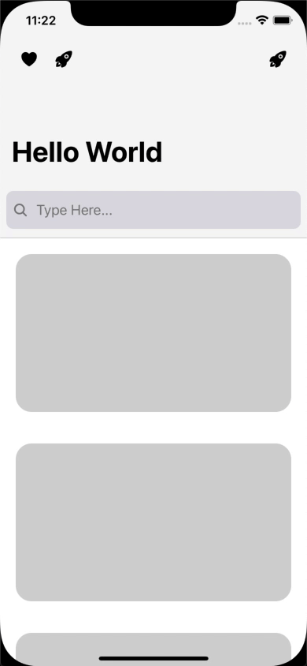

# React Native Scrollable Navigation Bar

| [Image Background Example](https://zobeirhamid.github.io/react-native-scrollable-navigation-bar/examples/image-background) | [Search Bar Example](https://zobeirhamid.github.io/react-native-scrollable-navigation-bar/examples/search-bar) |
| :------------------------------------------------------------------------------------------------------------------------: | :------------------------------------------------------------------------------------------------------------: |
|                                                                         |                                                                         |

## Getting Started

[Check out the docs](https://zobeirhamid.github.io/react-native-scrollable-navigation-bar)

## Compatibility

Tested and building cleanly against **React Native 0.86** (New Architecture, mandatory since RN
0.82). `peerDependencies` require `react >=18.0.0` and `react-native >=0.72.0`.

The library itself has no native code — it's pure JS/TSX built on top of the `Animated` API — so it
should keep working across a wide range of RN versions as long as `react-native`'s own JS APIs stay
compatible. See [`docs/rn-0.86-migration.md`](./docs/rn-0.86-migration.md) for the full compatibility
audit and known limitations, including an Android edge-to-edge caveat around `StatusBar` behavior.

## Features

- 60 FPS scroll animations
- Works on all Platforms
- Uses react-native Animated API, so no extra dependencies are needed
- Fully customizable

## Roadmap

- [ ] Custom RefreshControl Animation
- [ ] Supporting FlatList
- [ ] ScrollView Methods

## Bugs

- Web[iOS]: Bouncing won't scale up the HeaderBackground Component
- Web: Border flickering
- RegularNavigationBar: If `collapsible=true`, `stickyCollapsible=true`, and a `SnapComponent` exists, so the `StickyComponent` collapses too early, as it does not count in `snapHeight`
- Android: `StatusBar.setTranslucent()` (used internally to draw the header behind the status bar) becomes a no-op once the host app targets Android 15+ (`targetSdkVersion 35+`), which enforces edge-to-edge and deprecates that API at the OS level — this is already the default `targetSdkVersion` in the RN 0.86 app template. Actual visual impact hasn't been validated on a real Android 15+ device yet; see the "Etapa 4" findings in [`docs/rn-0.86-migration.md`](./docs/rn-0.86-migration.md)
